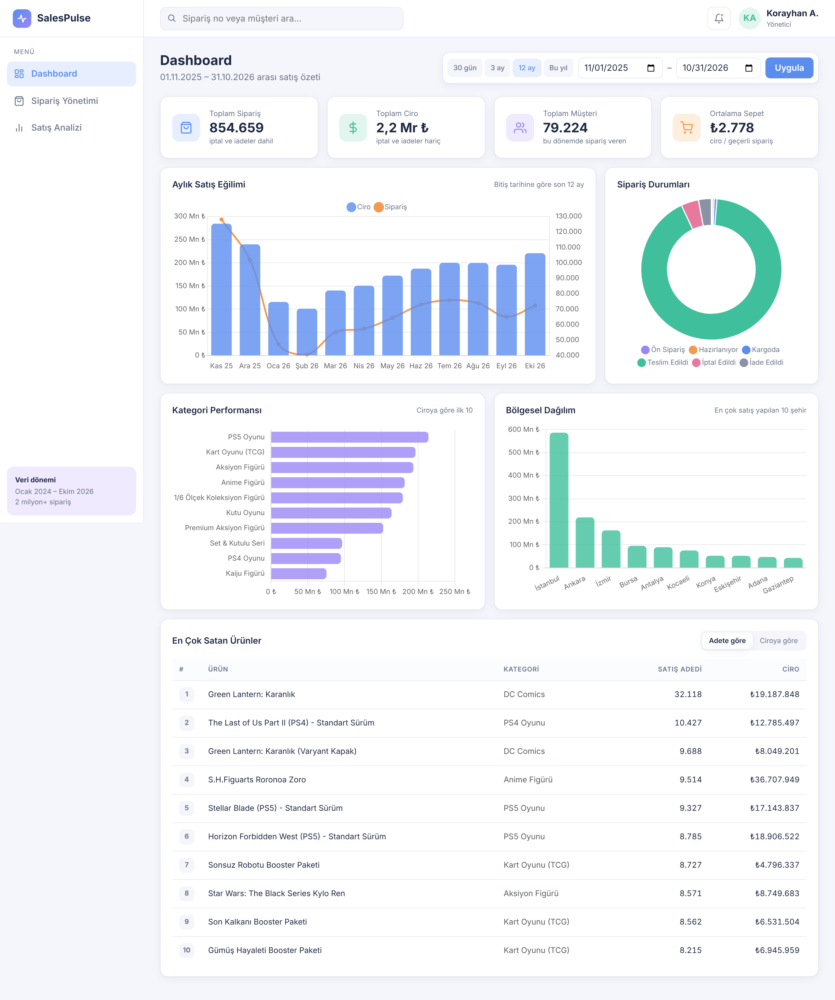
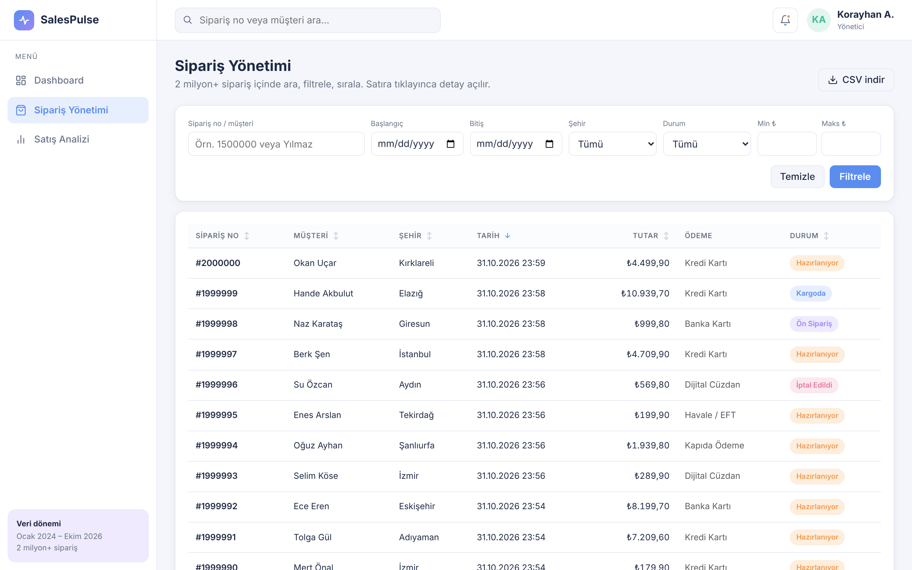
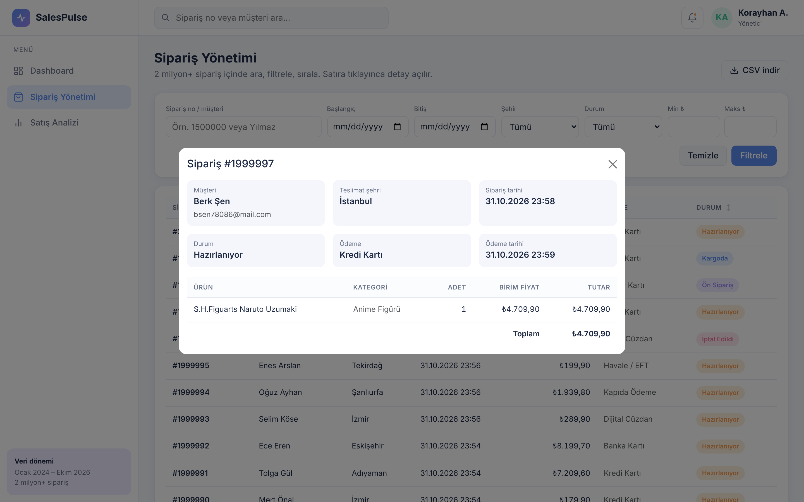
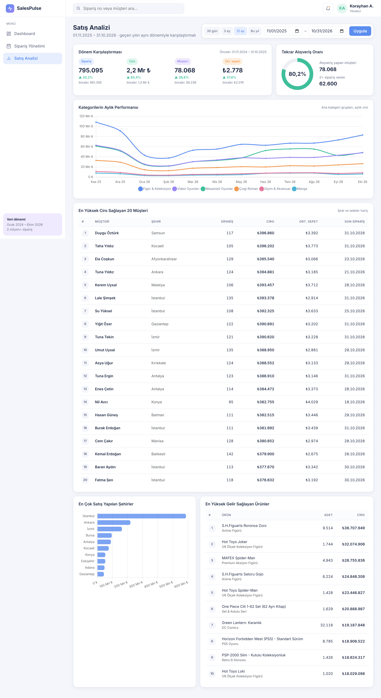
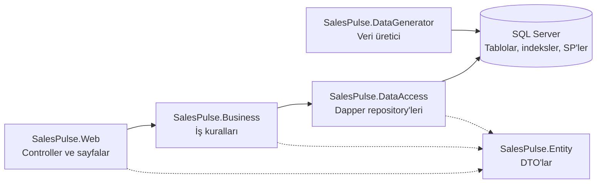
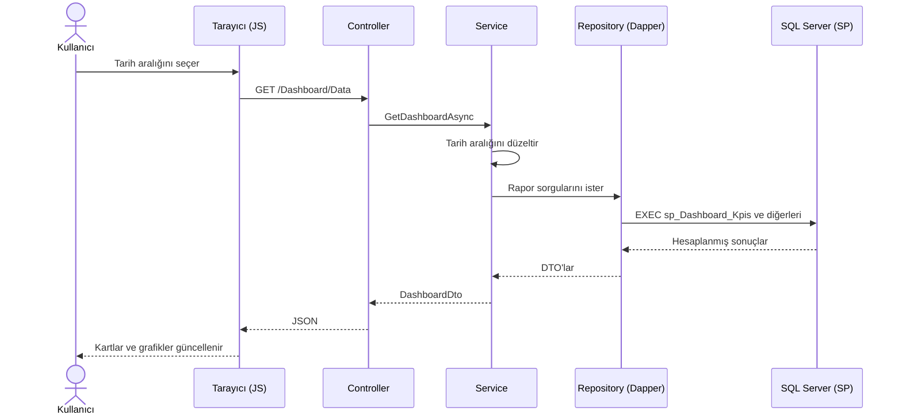
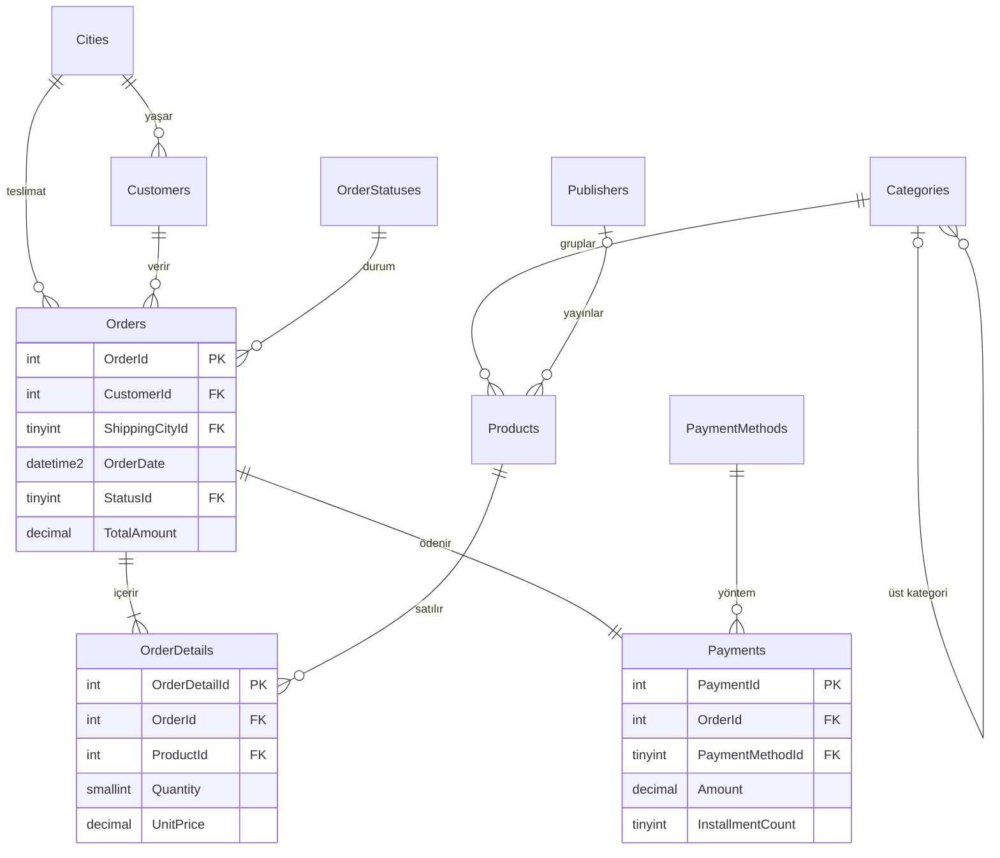
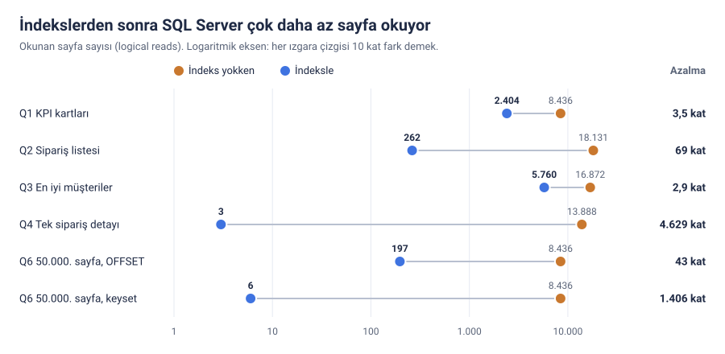
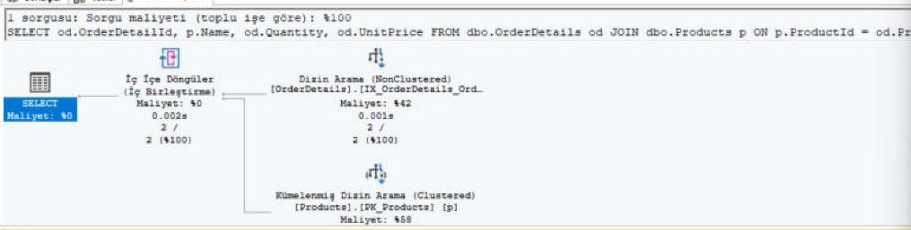
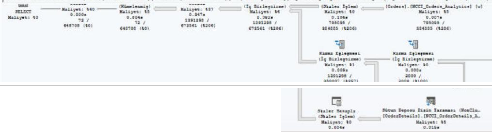

<div align="center">

# SalesPulse

**2 milyon siparişli bir e-ticaret mağazası için yönetim paneli**


M&Y Yazılım Eğitim Akademi — 7. Proje (Dapper Case)



| 2.000.000 | 3.500.065 | 100.000 | 13 | 7 |
|:---:|:---:|:---:|:---:|:---:|
| sipariş | sipariş kalemi | müşteri | stored procedure | indeks |

</div>

---

## Bu proje ne?

Türkiye'nin her yerine çizgi roman, manga, figür, video oyunu ve kutu oyunu satan hayali bir "geek" mağazası düşünün. Mağaza birkaç yılda 2 milyon sipariş almış. Yönetici sabah paneli açtığında şu sorulara birkaç saniyede cevap görmek istiyor:

- Bu ay kaç sipariş geldi, ne kadar ciro yaptık?
- En çok hangi kategoriler, hangi şehirler, hangi ürünler satıyor?
- Müşteriler geri geliyor mu? Geçen yılın aynı dönemine göre neredeyiz?
- Şu müşterinin geçen hafta verdiği sipariş nerede kaldı?

SalesPulse bu soruları üç sayfada cevaplıyor:

| Sayfa | Ne gösteriyor |
|---|---|
| **Dashboard** | 4 KPI kartı (sipariş, ciro, müşteri, ortalama sepet), aylık satış trendi, en iyi 10 kategori / şehir / ürün, sipariş durumları |
| **Sipariş Yönetimi** | 2 milyon sipariş içinde arama, filtreleme, sıralama, sayfalama, sipariş detayı ve CSV'ye aktarma |
| **Satış Analizi** | En çok harcayan 20 müşteri, kategorilerin aylık performansı, tekrar alışveriş oranı, geçen yılla karşılaştırma |

### Ekran görüntüleri

Büyütmek için görsele tıklayın.

<table>
  <tr>
    <td width="34%" valign="top">
      <a href="docs/screenshots/orders.png"></a>
      <br /><b>Sipariş Yönetimi</b><br />
      <sub>2 milyon sipariş içinde arama, filtre, sıralama ve sayfalama</sub>
    </td>
    <td width="33%" valign="top">
      <a href="docs/screenshots/order-detail.png"></a>
      <br /><b>Sipariş detayı</b><br />
      <sub>Bir satıra tıklayınca açılan pencere</sub>
    </td>
    <td width="33%" valign="top">
      <a href="docs/screenshots/sales.png"></a>
      <br /><b>Satış Analizi</b><br />
      <sub>Geçen yılla karşılaştırma, tekrar alışveriş oranı, kategorilerin aylık performansı, en iyi müşteriler</sub>
    </td>
  </tr>
</table>

Projede asıl öğrenmek istediğim şey ekran yapmak değildi. Asıl soru şuydu: **2 milyon satırlık bir tabloyu yavaşlatmadan nasıl sorgularım?** Bu yüzden projenin tek bir kuralı var:

> Veri asla C#'a çekilip orada toplanmaz. Filtreleme, toplama, sıralama ve sayfalama SQL Server'da yapılır; uygulamaya sadece ekranda gösterilecek sonuç gelir.

---

## Önce birkaç kavram

Bu projeye başlarken bu kavramları ben de tam bilmiyordum. Kendi anladığım şekliyle yazıyorum:

**İndeks:** Kitabın arkasındaki dizin gibi. 1.000 sayfalık bir kitapta "Dapper" kelimesini bulmak için her sayfayı çevirmezsin; dizinde "D" harfine gidip doğru sayfaya atlarsın. Veritabanında da indeks, bir kolona göre sıralanmış ayrı bir liste. Örneğin siparişler tarihe göre indekslenmişse, "Ekim 2026 siparişleri" dendiğinde SQL Server doğrudan Ekim'e atlar (**Seek**). 2 milyon satırın hepsine tek tek bakmaz (**Scan**). Bedeli: biraz yer kaplar ve her yeni kayıtta güncellenmesi gerekir. Bu yüzden her kolona değil, sadece gerçekten arama yapılan kolonlara konur.

**Stored procedure (SP):** Veritabanına bir isimle kaydedilmiş hazır bir SQL sorgusu. Restoranda tarifi baştan anlatmak yerine "bir menemen" demek gibi. Uygulama uzun SQL göndermez, sadece SP'nin adını ve parametreleri söyler:

```sql
EXEC dbo.sp_Dashboard_Kpis @StartDate = '2026-01-01', @EndDate = '2026-10-31';
```

Böylece SQL tek yerde durur, değiştirmek için C# koduna dokunmak gerekmez. Parametreler değer olarak gittiği için SQL injection da yapılamaz.

**Dapper:** SQL'den gelen satırları kolon adlarına bakarak C# sınıflarına otomatik dolduran küçük, hızlı bir kütüphane. SP `TotalOrders` diye bir kolon döndürürse, bu değer `KpiDto.TotalOrders` property'sine yerleşir.

**DTO:** Sadece veri taşıyan sade bir sınıf. İçinde mantık yok, sadece property'ler var.

---

## Proje nasıl kurgulandı?

Projeyi katmanlara ayırdım. Kafamda bir restoran gibi canlandırdım: herkes sadece kendi işini yapıyor.

```
SalesPulse.sln
├── SalesPulse.Entity          → DTO'lar: veriyi taşıyan sınıflar ("tabaklar")
├── SalesPulse.DataAccess      → Veritabanıyla konuşan tek katman ("garson")
│   ├── Connection/            → Bağlantıyı açan fabrika
│   └── Repositories/          → Dashboard, Order, Sales, Lookup (Dapper burada)
├── SalesPulse.Business        → İş kuralları ("şef"): tarih aralığı, sayfa boyutu sınırı, CSV
├── SalesPulse.Web             → Controller'lar, sayfalar, Program.cs ("karşılayıcı")
├── SalesPulse.DataGenerator   → 2 milyon siparişi üreten konsol uygulaması
└── database/                  → Bütün SQL dosyaları (tablolar, indeksler, SP'ler, testler)
```

Katmanlar birbirine tek yönde bağlı:



Dashboard'da tarih değiştirilince olanlar:



Controller SQL bilmez, repository iş kuralı bilmez. Bir yeri değiştirmek gerektiğinde nereye bakacağımı biliyorum.

**Kullandığım teknolojiler:** ASP.NET Core 8 MVC, Dapper, Microsoft.Data.SqlClient (bağlantı ve `SqlBulkCopy`), SQL Server 2022 Express, Bootstrap 5 ve grafikler için Chart.js.

---

## Kendi bilgisayarında çalıştırmak

**Gerekenler:** Visual Studio 2022 (ya da .NET 8 SDK), SQL Server 2019+ (Express yeterli) ve SSMS.

**1. Sunucu adını değiştir.** İki yerde benim sunucumun adı (`KORAYHAN\SQLEXPRESS`) yazıyor, kendi sunucunun adını yaz:
- `SalesPulse.Web/appsettings.json` → `ConnectionStrings:SqlConnection`
- `SalesPulse.DataGenerator/Settings.cs` → `ConnectionString`

**2. Veritabanını ve tabloları oluştur.** SSMS'te sırayla çalıştır:
```
database/00_create_database.sql   → SalesPulseDb veritabanı
database/01_tables.sql            → Tablolar, PK/FK ilişkileri, sabit veriler (şehirler, durumlar…)
```
> ⚠️ `01_tables.sql` tabloları silip baştan oluşturur. Veriyi bastıktan sonra çalıştırırsan **bütün veri gider**.

**3. Veriyi üret (yaklaşık 3 dakika).** Visual Studio'da `SalesPulse.DataGenerator`'ı başlangıç projesi yap ve Ctrl+F5 ile çalıştır. Önce veritabanına yazmadan denemek istersen: `dotnet run -- --dry-run`

**4. Veriyi kontrol et.** `database/05_verify_data.sql` satır sayılarını, FK'leri ve tutar tutarlılığını kontrol eder. "Sonuc" kolonunda HATA görmemen lazım.

**5. İndeksleri, SP'leri ve sunucu ayarını ekle.**
```
database/04_performance_tests.sql   → Önce indeks YOKKEN çalıştır, süreleri not al
database/02_indexes.sql             → 7 indeks
database/03_stored_procedures.sql   → 13 stored procedure
database/04_performance_tests.sql   → Tekrar çalıştır, farkı gör
database/06_server_settings.sql     → SQL Server'a en az 1 GB bellek ayır (nedeni aşağıda)
```

**6. Uygulamayı aç.** `SalesPulse.Web`'i başlangıç projesi yap ve F5'e bas. Dashboard açılır.

---

## Veritabanı



| Tablo | Satır | İçinde ne var |
|---|---|---|
| Orders | 2.000.000 | Sipariş tarihi, müşteri, teslimat şehri, durum, toplam tutar |
| OrderDetails | 3.500.065 | Siparişin kalemleri: ürün, adet, satış anındaki fiyat |
| Payments | 2.000.000 | Ödeme yöntemi, taksit, ödeme tarihi |
| Customers | 100.000 | Ad, soyad, e-posta, şehir, kayıt tarihi |
| Products | 2.000 | Ürün adı, fiyat, çıkış tarihi, sınırlı üretim bilgisi |
| Categories | 39 | 6 ana grup (Çizgi Roman, Manga, Figür…) ve 33 alt kategori |
| Cities | 81 | Plaka koduyla 81 il |
| Publishers | 29 | Yayınevleri ve markalar |
| OrderStatuses | 6 | Ön Sipariş, Hazırlanıyor, Kargoda, Teslim Edildi, İptal, İade |
| PaymentMethods | 5 | Kredi kartı, banka kartı, havale, kapıda ödeme, dijital cüzdan |

Bilerek verdiğim birkaç karar:

- **Toplam tutarı ve teslimat şehrini siparişin üzerinde de tuttum.** Normalde kalemlerden ve müşteriden hesaplanabilirler. Ama böylece dashboard'daki raporların çoğu 3,5 milyonluk kalem tablosuna JOIN yapmadan hesaplanabiliyor.
- **Kalemde satış anındaki fiyatı sakladım.** Ürünün fiyatı yarın değişse bile geçmiş siparişlerin tutarı bozulmuyor.
- **Şehir ID'si plaka kodu.** İstanbul 34, Ankara 6. Bu yüzden otomatik artan (IDENTITY) değil.

---

## Veriyi nasıl ürettim?

Case, verinin hazır bir JSON dosyasından gelmemesini istiyordu. Ben de C# ile bir veri üretici yazdım (`SalesPulse.DataGenerator`). Amacım rastgele sayılar değil, **gerçek bir mağazaya benzeyen** veriydi. Bütün ayarlar `Settings.cs` dosyasında:

- **Mevsimler var.** Kasım'da satış 1,8 kat (Black Friday), Aralık'ta 1,6 kat, Şubat'ta 0,7 kat. 11.11'de 2 kat, Black Friday'de 3 kat sipariş geliyor.
- **Mağaza büyüyor.** Her yıl %20 daha fazla sipariş var. Hafta sonları %15 daha yoğun. Gece az sipariş geliyor, akşam 20:00–22:00 arası zirve.
- **Şehirler farklı.** Siparişler nüfusa ve e-ticaret yoğunluğuna göre dağılıyor; İstanbul açık ara önde.
- **Sadık müşteriler var.** Müşterilerin %20'si "koleksiyoncu" ve siparişlerin yaklaşık %60'ını onlar veriyor. Hiçbir müşteri kayıt olmadan önce sipariş veremiyor.
- **Ürünler gerçekçi.** Yeni bir ürün çıkmadan 45 gün önce ön siparişe açılıyor. Yazın bazı kategoriler 1,6 kat daha çok satıyor.
- **Fiyatlar zamanla değişiyor.** Eski siparişlerde fiyatlar yıllık %35 enflasyonla geriye doğru düşürülüyor. Black Friday'de %10–25 indirim var.
- **Her sipariş mutlu bitmiyor.** %4'ü iptal, %3'ü iade ediliyor. Son günlerin siparişleri henüz "Hazırlanıyor" ya da "Kargoda".
- **Ödemeler mantıklı.** %55'i kredi kartıyla yapılıyor. Taksit sadece kredi kartında ve 1.000 TL üstünde var.

Üretici sabit bir seed (2024) kullanıyor; her çalıştırmada birebir aynı veriyi üretiyor. `SqlBulkCopy` ile 50.000'lik paketler hâlinde yazdığı için 2 milyon sipariş, kalemleri ve ödemeleriyle birlikte yaklaşık **3 dakikada** yükleniyor.

**Sonuç:** 2.000.000 sipariş, 3.500.065 kalem. Müşterilerin %87,4'ü tekrar alışveriş yapmış. Siparişlerin %92,5'i teslim edilmiş, %4'ü iptal, %3'ü iade.

---

## İndeksler ve stored procedure'ler

### İndeksler (`02_indexes.sql`)

İndeksleri, SP'lerin içindeki sorgulara bakıp "bu sorgu hangi kolona göre arıyor?" diye sorarak seçtim. Hangi indeksin kullanılacağına SQL Server her seferinde kendisi karar veriyor; benim işim doğru indeksleri hazır etmekti.

| İndeks | Neden var |
|---|---|
| `IX_Orders_OrderDate` (+ müşteri, şehir, durum, tutar INCLUDE) | Neredeyse her rapor tarih aralığıyla çalışıyor. INCLUDE sayesinde rapor asıl tabloya hiç gitmeden cevap verebiliyor. |
| `IX_Orders_CustomerId_OrderDate` | Müşteri bazlı raporlar: en iyi müşteriler, tekrar alışveriş oranı |
| `IX_OrderDetails_OrderId` | Bir siparişin kalemlerini bulmak (detay penceresi) |
| `UX_Payments_OrderId` (UNIQUE) | Siparişin ödemesini bulmak. Ayrıca her siparişin tek ödemesi olmasını garanti ediyor. |
| `IX_Products_CategoryId` | Ürünleri kategorilere bağlamak |
| `NCCI_Orders_Analytics` (columnstore) | Milyonlarca satırı toplayan büyük raporlar |
| `NCCI_OrderDetails_Analytics` (columnstore) | 3,5 milyon kalemi toplayan kategori ve ürün raporları |

Son ikisi farklı bir indeks türü. Normal indeksler veriyi satır satır saklar ve "şu tek siparişi bul" demek için mükemmeldir. **Columnstore** ise veriyi sütun sütun ve sıkıştırarak saklar. "12 ayın toplam cirosu" gibi milyonlarca satırı toplayan sorgularda çok daha az veri okunur.

### Stored procedure'ler (`03_stored_procedures.sql`)

Her sayfanın SP'leri ayrı. Toplam 13 tane:

| Sayfa | SP | Ne yapıyor |
|---|---|---|
| Dashboard | `sp_Dashboard_Kpis` | 4 KPI kartı |
| | `sp_Dashboard_MonthlyTrend` | Son 12 ayın satışı ve sipariş sayısı |
| | `sp_Dashboard_TopCategories` | Ciroya göre ilk 10 kategori |
| | `sp_Dashboard_TopCities` | En çok satış yapılan 10 şehir |
| | `sp_Dashboard_StatusDistribution` | Sipariş durumlarının dağılımı |
| | `sp_Dashboard_TopProducts` | Adete ya da ciroya göre ilk 10 ürün |
| Sipariş Yönetimi | `sp_Orders_Search` | Arama, filtre, sıralama ve OFFSET/FETCH ile sayfalama |
| | `sp_Orders_GetDetail` | Siparişin bilgileri ve kalemleri |
| | `sp_Orders_Export` | Filtrelenmiş siparişleri CSV için verir (en fazla 10.000 satır) |
| Satış Analizi | `sp_Sales_TopCustomers` | En çok ciro yapan 20 müşteri |
| | `sp_Sales_CategoryMonthly` | Ana kategorilerin aylık cirosu |
| | `sp_Sales_RepeatCustomerRate` | Tekrar alışveriş oranı (GROUP BY + HAVING) |
| | `sp_Sales_PeriodComparison` | İki tarih aralığını karşılaştırır |

Bütün SP'lerde uyduğum birkaç kural:

- **Tarih filtresini indeksin kullanabileceği şekilde yazdım:** `OrderDate >= @Start AND OrderDate < @End + 1 gün`. Kolonu bir fonksiyonun içine (`YEAR(OrderDate) = 2026` gibi) sokarsan SQL Server indeksi kullanamaz.
- **Ciroya iptal ve iadeleri katmadım.**
- **Sipariş aramasında sıralama kolonu dinamik.** Kullanıcının gönderdiği kolon adını doğrudan SQL'e yapıştırmıyorum. Önce izin verilen kolonlar listesiyle karşılaştırıyorum, sonra `sp_executesql` ile parametreli çalıştırıyorum. Böylece SQL injection'a kapı açılmıyor.

---

## Performans: önce ve sonra

Projenin en çok şey öğrendiğim kısmı burası oldu.

**Nasıl ölçtüm:** SQL Server 2022 Express, kendi bilgisayarım, `SET STATISTICS IO, TIME ON`. Her sorguyu indeks öncesi ve sonrası için birer kez çalıştırdım; tablodaki süreler ham kayıtlardaki süre satırlarından alındı. Önce indeks yokken ölçtüm, sonra indeksleri ekleyip tekrar ölçtüm. Ham çıktılar `database/perf_before_messages.txt` ve `database/perf_after_messages.txt` dosyalarında.

"Logical reads" SQL Server'ın kaç sayfa (8 KB'lık blok) okuduğunu gösteriyor. Süre bilgisayarın o anki durumuna göre oynayabilir, ama okunan sayfa sayısı yalan söylemez.

| Sorgu | Önce | Sonra | Okunan sayfa | Kullanılan indeks |
|---|---|---|---|---|
| Q1 Dashboard KPI'ları (2026 Ocak–Ekim) | 445 ms | 372 ms | 8.436 → 2.404 | IX_Orders_OrderDate |
| Q2 Sipariş listesi, 1. sayfa (İstanbul, son 3 ay) | 1.564 ms | 15 ms | ~18.100 → 262 | IX_Orders_OrderDate + UX_Payments_OrderId |
| Q3 En iyi 20 müşteri + tekrar oranı (2025) | 853 ms | 687 ms | 16.872 → 5.760 | IX_Orders_OrderDate |
| Q4 Tek siparişin detayı | 229 ms | 0 ms | 13.888 → 3 | IX_OrderDetails_OrderId |
| Q6 50.000. sayfaya atlamak: OFFSET / keyset | 798 / 845 ms | 6 / 0 ms | 8.436 → 197 / 6 | IX_Orders_OrderDate |
| Q7 Kategorilerin aylık performansı (son 12 ay) | 44 sn (soğuk) / 4 sn | 1,3 sn | 12.575 + 8.436 → ~4.351 + ~2.556 | Columnstore indeksler |



> Q1–Q6 ham kayıtlardan alındı. Q7 ise columnstore indeksler eklenirken ayrıca ölçüldü, bu yüzden `perf_*` dosyalarında yer almıyor. Planı `07_execution_plans.sql` ile görülebilir.

### Execution plan'ler

Tek siparişin kalemleri (Q4). SQL Server 3,5 milyon satırlık tabloyu taramıyor, `IX_OrderDetails_OrderId` indeksinde doğrudan aradığı yere gidiyor (**Dizin Arama / Index Seek**):



Kategorilerin aylık performansı (Q7, `sp_Sales_CategoryMonthly`). Hem Orders hem OrderDetails, columnstore indekslerden okunuyor (**Sütun Deposu Dizin Taraması / Columnstore Index Scan**):



Planları kendin görmek istersen sorgular `database/07_execution_plans.sql` dosyasında.

### Öğrendiklerim

**1. Az satır isteyen sorgularda indeks mucize gibi.** Tek bir siparişin kalemlerini bulmak için (Q4) SQL Server önce 13.888 sayfa okuyordu, yani 3,5 milyon satırın hepsine bakıyordu. İndeksten sonra 3 sayfa okuyor: kök → ara → yaprak, bitti. Q2, Q4 ve Q6 yüz kattan fazla hızlandı.

**2. Çok satır toplayan sorgularda tek başına yetmiyor.** Q1 ve Q3 tablonun üçte birini topluyor. Okunan sayfa 3,5 kat azaldı ama süre sadece %16–20 kısaldı, çünkü asıl zaman saymaya ve gruplamaya gidiyor. Okumayı hızlandırmak tek başına yetmedi.

**3. Bir sorgu, en zayıf JOIN'i kadar hızlı.** Q2'de sadece tarih indeksi varken sorgu daha da yavaşladı: **2.320 ms**. Sebebi şuydu: listedeki 25 siparişin her biri için ödeme tablosu baştan taranıyordu (5,7 milyon okuma). `Payments.OrderId`'ye indeks ekleyince 0 ms'ye indi. O günden beri kuralım: **foreign key kolonlarına her zaman indeks koy.**

**4. Columnstore, büyük raporları kurtardı.** Satış Analizi sayfası bir gün hiç açılmadı ve 120 saniye sonra zaman aşımı hatası verdi. Suçlu Q7'ydi: 12 ayın bütün sipariş kalemlerini topluyor. Bilgisayar yeni açıldığında 44 saniye, ısındıktan sonra bile 4 saniye sürüyordu. Columnstore indeksleri ekleyince okunan veri yaklaşık 3 kat azaldı. SQL Server satırları tek tek değil, yüzlerce satırlık paketler hâlinde (batch mode) işlemeye başladı ve süre 1,3 saniyeye indi.

**5. Sorgu kadar sunucu ayarı da önemli.** Bunu hiç beklemiyordum. Columnstore'dan sonra her şey hızlıydı. Yarım saat sonra aynı raporlar yine 2 dakikaya çıktı. Araştırınca gördüm ki bilgisayarda Visual Studio, tarayıcı ve başka programlar açıkken boşta sadece 820 MB RAM kalmıştı. Windows da SQL Server'ın belleğini geri almıştı; veritabanının bellekteki payı **0 MB**'a düşmüştü. SQL Server'ın "en az şu kadar bellek kullan" ayarı varsayılan olarak sadece 16 MB.

`06_server_settings.sql` ile iki ayar yaptım:
- SQL Server'a en az 1 GB bellek ayırdım. Veritabanı yaklaşık 500 MB olduğu için artık bütünüyle bellekte durabiliyor.
- Paralel çalışma eşiğini 5'ten 50'ye çıkardım. Böylece küçük sorgular gereksiz yere çekirdeklere bölünüp birbirini beklemiyor.

Sonuç: Dashboard **~1,2 sn**, Satış Analizi **~1,7 sn**'de açılıyor. 3 yıllık veriyle 4 ağır rapor aynı anda istendiğinde bile en uzun istek ~8 saniye sürdü; zaman aşımı olmadı.

**6. Derin sayfalarda keyset sayfalama daha iyi.** OFFSET ile 50.000. sayfaya atlamak için SQL Server önceki bütün satırları sayıp atlamak zorunda. Keyset'te "son gördüğüm siparişten sonrakileri ver" diyorsun ve kaçıncı sayfada olursan ol maliyet aynı kalıyor (6 sayfa okuma).

**Neyi bilerek yapmadım:** Raporları hızlandırmak için önbellek ya da önceden hesaplanmış özet tablolar kullanmadım. Case, raporların canlı veritabanı sorgularından gelmesini istiyordu; bütün sayılar her açılışta gerçek tablolardan hesaplanıyor.

---

## Uygulama adresleri

Sayfalar ve arka plandaki JSON uç noktaları:

| Adres | Ne döner |
|---|---|
| `/Dashboard` | Dashboard sayfası |
| `/Dashboard/Data?startDate=2026-01-01&endDate=2026-10-31` | Dashboard verisi (JSON) |
| `/Orders` | Sipariş Yönetimi sayfası |
| `/Orders/List?search=Yılmaz&cityId=34&statusId=4&page=2&pageSize=25&sortColumn=TotalAmount&sortDir=DESC` | Sayfalı sipariş listesi (JSON) |
| `/Orders/Detail/1500000` | Tek siparişin detayı (JSON, sipariş yoksa 404) |
| `/Orders/Export?cityId=34&startDate=2026-10-01&endDate=2026-10-31` | CSV dosyası |
| `/Sales` | Satış Analizi sayfası |
| `/Sales/Data?startDate=2026-01-01&endDate=2026-10-31` | Satış Analizi verisi (JSON) |

Tarih seçilmezse varsayılan aralık **son 12 ay**. Veri 31.10.2026'da bitiyor.

---
